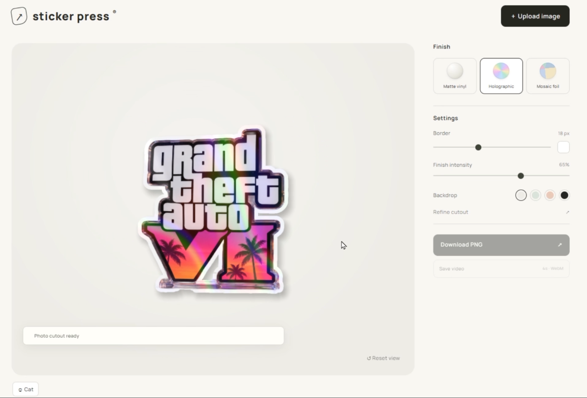
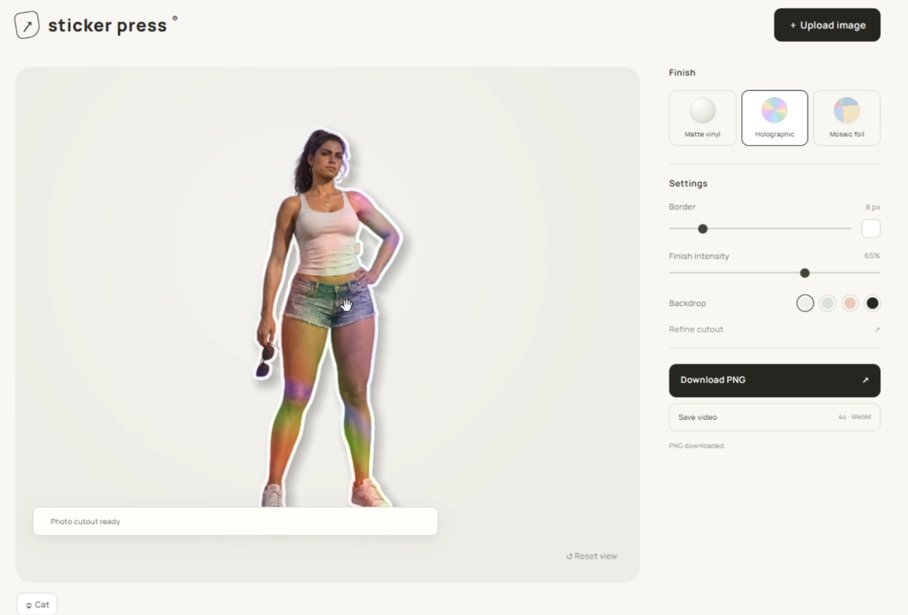
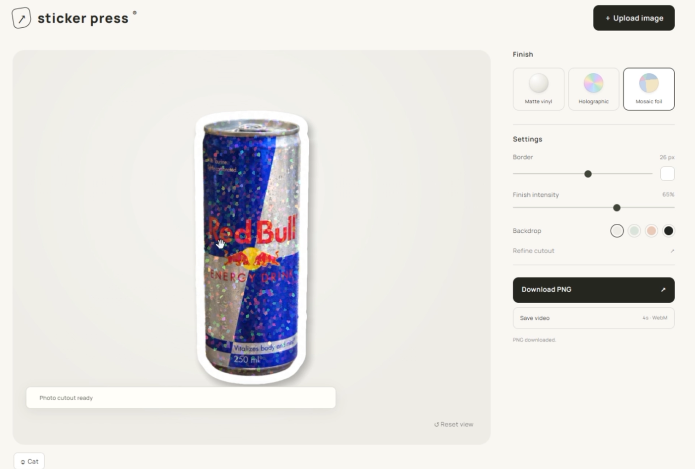
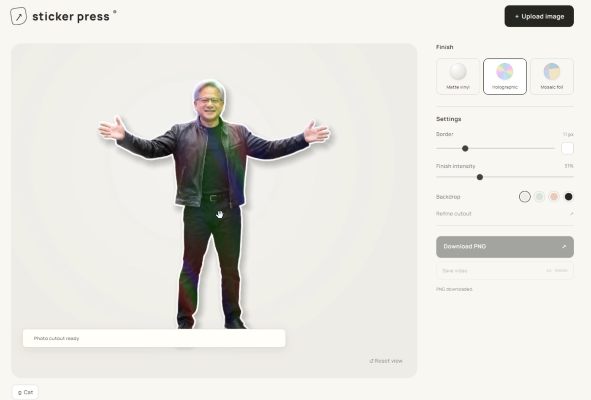
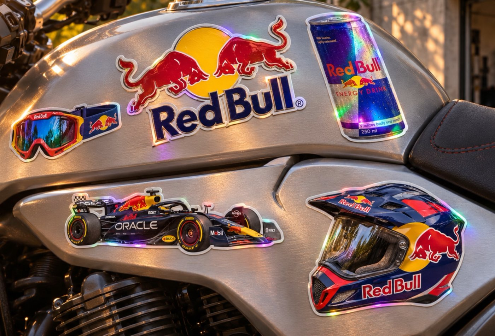
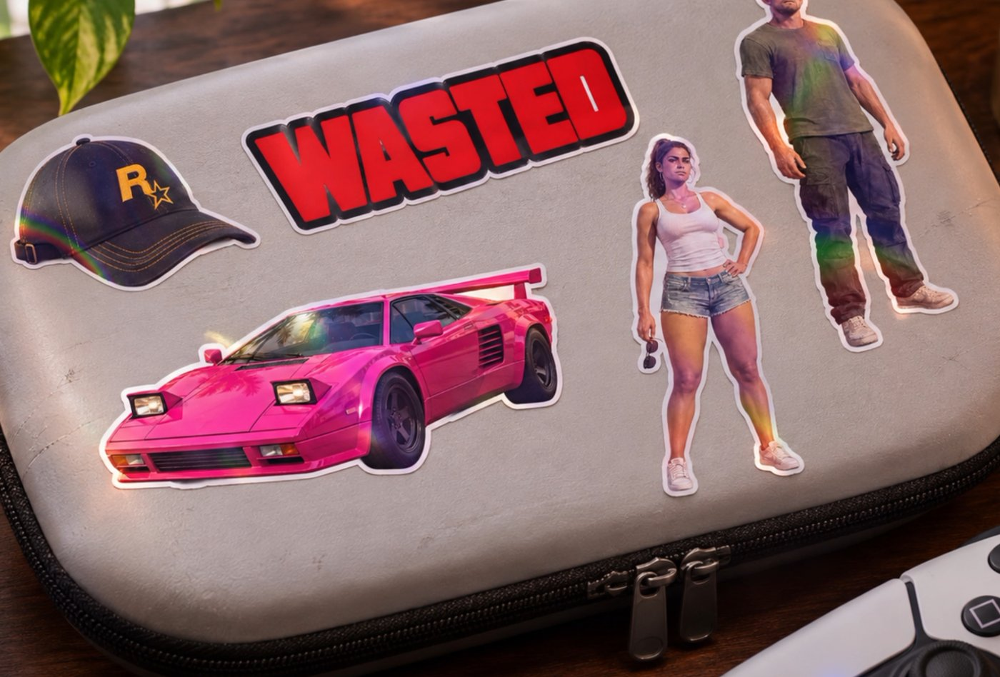

# Sticker Press

A small web tool for making custom stickers from photos and ready-made artwork. Upload → automatic cutout → material and outline → transparent PNG or a short video clip.

## Screenshots

<table>
  <tr>
    <td></td>
    <td></td>
  </tr>
  <tr>
    <td></td>
    <td></td>
  </tr>
</table>

### Concept mockups

Illustrations of how printed stickers could look. The tool itself exports a transparent PNG or a short video; it does not generate these previews and does not print.

## Quick start

1. Install Node.js 20 or newer if you don't have it.
2. Get the whole project folder (clone the repository or unpack the archive). On Windows, open `START.cmd`; or run `npm start` in this folder.
3. Open http://127.0.0.1:4192 in a modern Chrome or Edge with WebGL2.

For a regular launch you **don't need npm install, Python, API keys or a build step**. The main model and the prebuilt worker are included. Don't open index.html via file://.

If the port is busy: PowerShell `$env:PORT=4193; npm start`, then http://127.0.0.1:4193. Stop the server with Ctrl+C.

## What works

- One active sticker; upload of photos/images, including transparent PNGs.
- Automatic background removal with a local ISNet FP16 model in a Web Worker; transparent artwork keeps its original alpha.
- Manual refinement: add/erase brush, point selection, color key, Undo, Reset, Invert.
- Matte vinyl, Holographic, Mosaic foil; outline color and thickness, material intensity, preview background.
- Drag and tilt the sticker, reset position; a built-in example, a cat.
- Export a transparent PNG and a four-second video (WebM/MP4, depending on the browser).

Photos are processed in the browser; there is no API for uploading photos to a server. The main model runs from the local files in the package. The font, the additional semantic check, the fallback segmenter and point selection use the internet (Google Fonts / MediaPipe CDN). This is not a fully offline build of all the additional features.

## Development in Codex

Open the whole Sticker-Press folder as a project. First read AGENTS.md and HANDOFF.md. Sources and the pinned package-lock.json are included.

To change the worker: `npm ci`, then `npm run build:matting`. For regular HTML/CSS/JS edits, just reload the page. The model is already included; `download-matting-assets.py` is only needed to restore lost files and requires Python.

To check silhouette-part recovery: `node test/subject-guard.mjs`. `test/e2e.mjs` is the original upstream test for the old interface, not the current Sticker Press acceptance suite; do not treat it as a ready-made test set for the current UI.

## Limits of the current version

Complex backgrounds and thin details sometimes need manual correction. PNG is a raster export without a calibrated physical size, bleed or plotter cut contour. The on-screen holographic effect does not produce physical foil when printed. Physical stickers need printing and a suitable material.

The package hands over the current prototype for joint development. The origin and licenses of the components are described in SOURCE.md and vendor/: the upstream sticker-shader had no LICENSE, and background-removal is AGPL. These terms are preserved in the package; no license of its own was assigned on top of third-party code.

Photos, generations, mockups, user exports, node_modules, git history and caches are not included. The cat is embedded in the JS source and stays the starter example.
